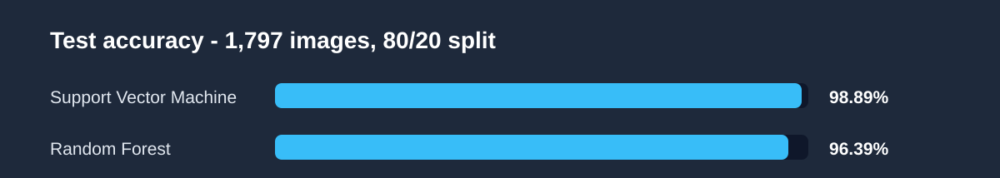

# Handwritten Digit Recognizer

  

A machine learning system that recognises handwritten digits (0–9) from 8×8 pixel images. Two classifiers are trained and benchmarked head to head on the same data, so the project demonstrates not just modelling, but **model evaluation and selection**.

## Results



| Model | Test accuracy |
|---|---|
| **Support Vector Machine** | **98.89%** |
| Random Forest (200 trees) | 96.39% |

Dataset: scikit-learn's built-in digits dataset — 1,797 images, stratified 80/20 train/test split. Running the training script also generates a confusion matrix (`results/confusion_matrix.png`), which shows exactly where the model errs (most often 8 vs 1 and 9 vs 7).

## How it works


Each image is flattened into 64 numeric features. The SVM finds the decision boundaries that separate the ten digit classes with the widest margin; the Random Forest votes across 200 decision trees. The better model on held-out data wins — here, the SVM.

## Quick start

```bash
pip install -r requirements.txt
python train.py     # train both models, print the comparison, save the confusion matrix
python predict.py   # predict a hand-drawn 8x8 digit grid (edit the grid to draw your own)
```

## What this project demonstrates

- Image data as features: turning pixels into a learnable representation
- Benchmarking two algorithm families on identical splits
- Evaluation beyond a single number: confusion-matrix analysis
- Reproducible experiments with fixed seeds and stratified splits

## Roadmap

- Neural network (MLP) comparison on the same benchmark
- Full MNIST (28×28) dataset
- Browser demo: draw a digit with the mouse, get a live prediction

---

**Author:** [Mehta Deven](https://github.com/mehtadeven) — IT student at SAL College of Engineering, Ahmedabad, building a public portfolio in Python, Machine Learning and AI.
**Portfolio:** [mehtadeven.github.io/portfolio](https://mehtadeven.github.io/portfolio/)

