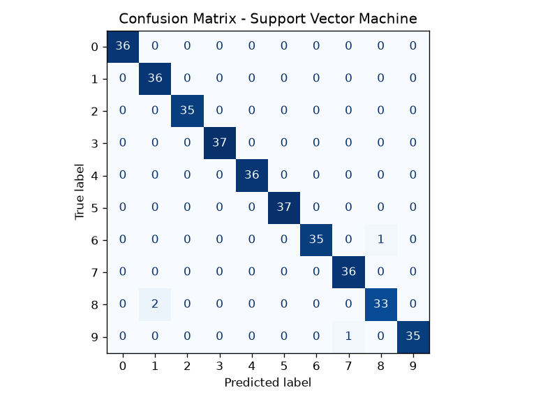
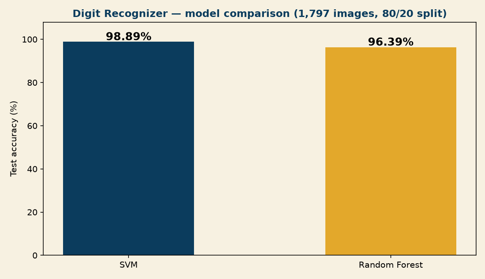
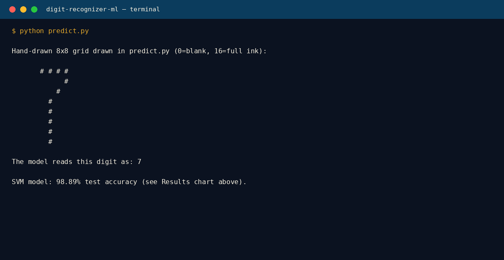
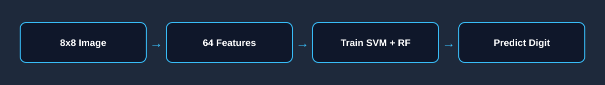

# Handwritten Digit Recognizer

[](https://mehtadeven.github.io/digit-recognizer-ml/)    [](LICENSE) 

**▶ [Try the live demo](https://mehtadeven.github.io/digit-recognizer-ml/)** — it runs in your browser, nothing to install.

A machine learning system that recognises handwritten digits (0–9) from 8×8 pixel images. Two classifiers are trained and benchmarked head to head on the same data, so the project demonstrates not just modelling, but **model evaluation and selection**.

## Who this helps

- **ML students learning classification** — see two real models trained on the same data and compared honestly, instead of a single unexplained accuracy number.
- **Teachers and mentors demoing ML** — the confusion matrix and per-digit accuracy show a class exactly where a model fails, which makes evaluation easy to explain live.
- **Beginners who want a first computer-vision project** — the dataset is built into scikit-learn, so there is nothing to download and the whole pipeline runs in minutes.
- **Interview preparation** — the code is short and readable enough to explain end to end: data split, training, evaluation, and model selection.

## Results


| Model | Test accuracy |
|---|---|
| **Support Vector Machine** | **98.89%** |
| Random Forest (200 trees) | 96.39% |

Dataset: scikit-learn's built-in digits dataset — 1,797 images, stratified 80/20 train/test split. Running the training script also generates a confusion matrix (`results/confusion_matrix.png`), which shows exactly where the model errs (most often 8 vs 1 and 9 vs 7).



*Confusion matrix — the model is near-perfect on the diagonal; the few errors are honest ones like 8 read as 1.*



*The chart above is generated by `generate_charts.py`, which trains both models on the same split as `train.py` — SVM 98.89%, Random Forest 96.39%. Per-digit accuracy (`python evaluate.py`): digit 8 is hardest at 94.29%; digits 0–5 and 7 score 100% on the test split.*

## Demo



*Real run of `python predict.py` — the hand-drawn 7 in `predict.py` is read as 7 by the saved SVM model.*

## Live demo

**[mehtadeven.github.io/digit-recognizer-ml](https://mehtadeven.github.io/digit-recognizer-ml/)** — draw a digit with your mouse or finger and the SVM recognises it live. The page shows the 8×8 image the model actually sees, the votes of its 45 one-vs-one classifiers, real test images to try, and the confusion matrix.

There is no server: [`export_web_model.py`](export_web_model.py) trains the same `SVC(gamma=0.001)` as `train.py` and exports its 705 support vectors to `web/digits-model.js`, and [`web/app.js`](web/app.js) computes the RBF-kernel decision in the browser — it predicts all 1,797 dataset images exactly like scikit-learn. Every push to `main` redeploys the demo through [`.github/workflows/pages.yml`](.github/workflows/pages.yml).

## How it works



Each image is flattened into 64 numeric features. The SVM finds the decision boundaries that separate the ten digit classes with the widest margin; the Random Forest votes across 200 decision trees. The better model on held-out data wins — here, the SVM.

## Download & run (2 minutes)

**Step 1 — Download the code**

```bash
git clone https://github.com/mehtadeven/digit-recognizer-ml.git
cd digit-recognizer-ml
```

No Git? On the GitHub page for this repo, click the green **Code** button, choose **Download ZIP**, unzip it, and open that folder in a terminal.

**Step 2 — Install what it needs** (Python 3.10 or newer)

```bash
pip install -r requirements.txt
```

**Step 3 — Run it**

```bash
python train.py     # first time only: train both models and save model.joblib
python predict.py   # predict the hand-drawn digit (edit the grid in predict.py to draw your own)
python evaluate.py  # optional: accuracy for each digit 0-9
```

**Step 4 — What you should see**

You should see `The model reads this digit as: 7` — exactly like the demo image above.

## Saved model

`train.py` also saves the winning model to `model.joblib`. After that,
`predict.py` loads the saved model instead of retraining every run, so
predictions are instant. If `model.joblib` is missing, `predict.py`
falls back to training a fresh SVM on the spot. The file is created
locally by `train.py` and is not committed to git.

## Tests

```bash
pip install pytest
python -m pytest tests/
```

The tests check the dataset shape, that a freshly trained SVM scores
above 95% on held-out data, and that the predict pipeline returns a
valid digit for the built-in example grid.

## What this project demonstrates

- Image data as features: turning pixels into a learnable representation
- Benchmarking two algorithm families on identical splits
- Evaluation beyond a single number: confusion-matrix analysis
- Reproducible experiments with fixed seeds and stratified splits

## Need help?

- **`pip` not found?** Use `python -m pip install -r requirements.txt` instead — it does the same thing.
- **Wrong folder error (file not found)?** Check your terminal is inside the repo folder — the prompt should end with the repo name, and `ls` (Mac/Linux) or `dir` (Windows) should list `README.md`.
- **Still stuck?** Open an Issue on this repo on GitHub with the command you ran and the full error message — that is the fastest way to get help.

## Contributing

Contributions are welcome — see [CONTRIBUTING.md](CONTRIBUTING.md) for
setup, how to run the tests, and how to suggest a change.

## Roadmap

- Neural network (MLP) comparison on the same benchmark
- Full MNIST (28×28) dataset
- Browser demo: draw a digit with the mouse, get a live prediction

---

**Author:** [Mehta Deven](https://github.com/mehtadeven) — IT student at SAL College of Engineering, Ahmedabad, building a public portfolio in Python, Machine Learning and AI.
**Portfolio:** [mehtadeven.github.io/portfolio](https://mehtadeven.github.io/portfolio/)

## Licence

MIT — see [LICENSE](LICENSE) for the full text.
